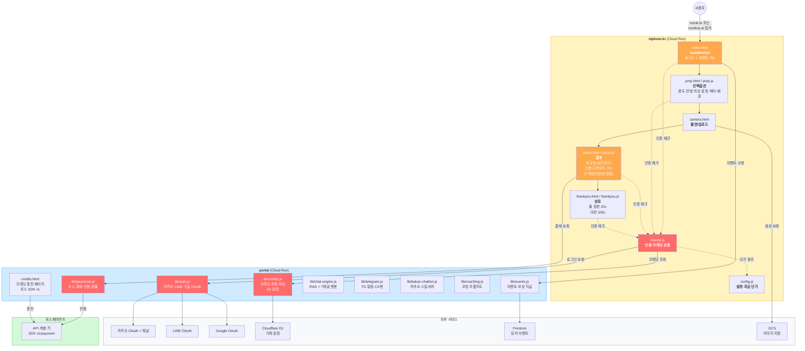
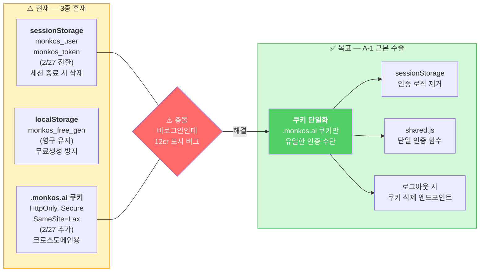
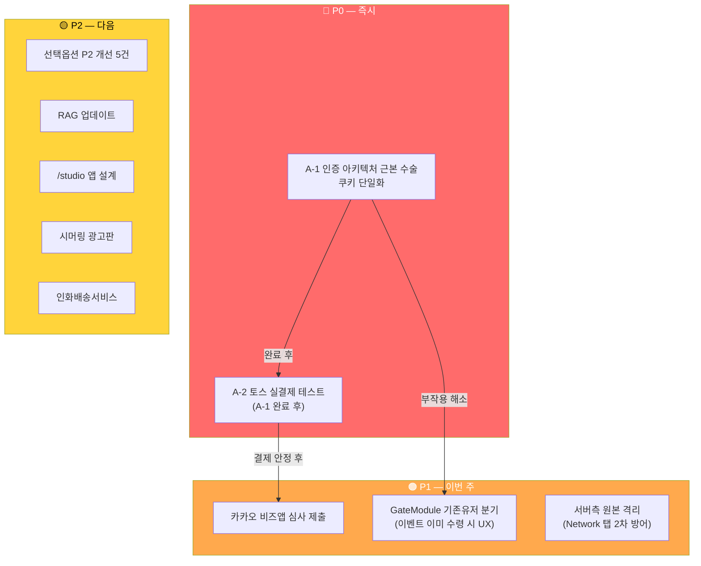

# MONKOS 서비스 아키텍처 노드맵

> M1/쌍아가 폴더 스캔 + 세션 로그 기반으로 작성.
> 코웍이가 Mermaid 아티팩트로 렌더링할 것.

---

## 1. 전체 프로젝트 구조

```mermaid
graph TD
    ROOT["monk_project<br/><b>MONK.KR / MONKOS.AI</b>"]

    ROOT --> MONKKR["<b>MONK_kr/</b><br/>메인 웹사이트<br/>monk.kr"]
    ROOT --> APPS["<b>apps/</b><br/>독립 앱 8개"]
    ROOT --> MAI["<b>monkos_AI/</b><br/>AI 프로덕션 앱"]
    ROOT --> OPS["<b>monkos-ops/</b><br/>운영 체계"]
    ROOT --> DOCS["<b>docs/</b><br/>지식 DB"]
    ROOT --> GOV["<b>governance/</b><br/>헌법·법률"]
    ROOT --> SAGA["<b>_saga/</b><br/>교육·소스"]
    ROOT --> MKT["<b>marketing/</b><br/>콘텐츠·자동화"]

    %% MONK_kr 하위
    MONKKR --> STUDIO["monk_studio/<br/>스튜디오 서비스"]
    MONKKR --> AILAB["ai_lab/<br/>AI 실험실"]
    MONKKR --> B2B["b2b/"]
    MONKKR --> ACADEMY["Academy/"]
    MONKKR --> CFW["cloudflare-workers/<br/>CF Worker API"]
    MONKKR --> CFWI["cloudflare-workers-imagen/<br/>Imagen Worker"]

    STUDIO --> IDPHOTO_S["id_photo/<br/>standard·premium·deluxe"]
    STUDIO --> PROFILE["profile/"]
    STUDIO --> FAMILY["family/"]
    STUDIO --> GROUP["group/"]

    AILAB --> PHOTOLAB["photolab/<br/>engine/"]
    AILAB --> IMGPRO["image_pro/"]
    AILAB --> LOOKBOOK["lookbook/"]
    AILAB --> MODELAG["model_agency/"]

    CFW --> VTXPROXY["vertex-ai-proxy/"]

    %% apps 하위
    APPS --> IMG4["<b>monk_imagen4/</b><br/>가장 복잡"]
    APPS --> AISTUDIO["monk-ai-studio-pro/"]
    APPS --> IMG3["imagen3/"]
    APPS --> CHAT["MonkosChat/"]
    APPS --> CAM["monk-cam/"]
    APPS --> COACH["photo-coach/"]
    APPS --> PLMPA["photolab-monkkr-mpa-0219/"]
    APPS --> PLLEG["photolab-monkkr-legacy/"]

    IMG4 --> IMG4_MOD["modules/<br/>imagen3-pro<br/>imagen4-generator<br/>lumina-lookbook"]
    IMG4 --> IMG4_CORE["components/ core/<br/>functions/ services/"]

    %% monkos_AI 하위
    MAI --> IDKR["<b>idphoto-kr/</b><br/>🇰🇷 증명사진 한국"]
    MAI --> IDJP["idphoto-jp/<br/>🇯🇵 증명사진 일본"]
    MAI --> PORTAL["<b>portal/</b><br/>통합 백엔드"]
    MAI --> INFRA["infrastructure/"]

    %% monkos-ops 하위
    OPS --> OP1["01_전략/"]
    OPS --> OP2["02_리서치/"]
    OPS --> OP3["03_개발/<br/>specs/ tasks/ releases/"]
    OPS --> OP4["04_문서/"]
    OPS --> OP5["05_공유/<br/>han/ kku/"]
    OPS --> OP6["06_로그/<br/>sessions/"]
    OPS --> OPSOPS["ops/<br/>orders/ reports/ sessions/"]

    %% 스타일
    style IDKR fill:#ff6b6b,color:#fff
    style PORTAL fill:#ff6b6b,color:#fff
    style IMG4 fill:#ffa94d,color:#fff
    style ROOT fill:#339af0,color:#fff
    style MONKKR fill:#51cf66,color:#fff
    style APPS fill:#51cf66,color:#fff
    style MAI fill:#51cf66,color:#fff
    style OPS fill:#868e96,color:#fff
    style DOCS fill:#868e96,color:#fff
    style GOV fill:#868e96,color:#fff
```

---

## 2. 서비스 흐름 (idphoto-kr 중심 — 디버깅 집중 영역)

---

## 3. 인증 상태 문제 (근본 수술 대상)

---

## 4. 미결 어젠다 우선순위

---

## 사용법

코웍이에게 이 파일을 넘기면서:
> "이 md 파일의 Mermaid 코드 블록 4개를 각각 아티팩트로 렌더링해줘"

라고 하시면 됩니다.
