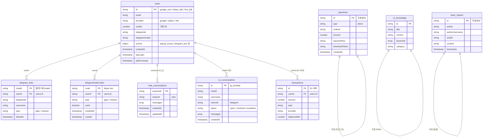

# 운영 데이터 조회 체계 — 상세 설계서

> **[2026-02-28 11:54 KST] iMac/막내1**
> **지시서**: ORDER_20260228_막내1_운영데이터조회체계
> **성격**: 기술 설계 (코딩 구현은 별도 지시서)

---

## 1. 목적

MONK OS는 Firestore 10개 컬렉션에 사용자/결제/텔레그램/챗봇 데이터를 저장하지만,
이 데이터를 **조회·분석·관리**할 운영 도구가 부재하다.

**해결 목표**:
- 회원/결제/통계를 CLI 한 줄로 즉시 확인
- 팀원(한송이, 꾸)에게 텔레그램·GDrive 경유로 데이터 접근 제공
- 테스트용 계정 리셋 시 연관 데이터 일괄 처리
- 법률에 운영 데이터 규정 편입 (별도 청구)

---

## 2. 설계 원칙

| 원칙 | 설명 |
|------|------|
| **단일 진입점** | `node monk-ops.mjs <command>` 하나로 모든 조회 |
| **읽기 전용 기본** | 조회 명령은 Firestore를 수정하지 않음 |
| **삭제는 확인 필수** | `user-reset`만 유일한 쓰기 명령, 확인 프롬프트 강제 |
| **3-format 출력** | 터미널 테이블(기본) / CSV / JSON |
| **zero-install** | portal과 동일한 `@google-cloud/firestore` 사용, 별도 패키지 최소 |

---

## 3. Firestore 접근 방식 — 비교 및 선정

### 후보 비교

| 항목 | `@google-cloud/firestore` SDK | REST API + gcloud auth |
|------|-------------------------------|------------------------|
| **설치** | `npm i @google-cloud/firestore` (portal에 이미 존재) | 없음 (curl + gcloud) |
| **인증** | ADC 자동 (gcloud auth application-default) | Bearer 토큰 수동 취득 |
| **코드 복잡도** | 낮음 — `db.collection('users').get()` | 높음 — REST 엔드포인트 + JSON 파싱 |
| **타입 변환** | 자동 (Timestamp → Date) | 수동 (Firestore REST format) |
| **일관성** | portal 코드와 동일 패턴 | 별도 패턴 |
| **의존성** | Node.js + 1 패키지 | gcloud CLI + curl |
| **M2 호환** | ✅ (Node.js 설치 되어있음) | ✅ |

### 선정: `@google-cloud/firestore` SDK

**근거**:
1. portal(`monkos_AI/portal/lib/shared/config.js`)과 **동일한 패키지·패턴** 사용 → 유지보수 통일
2. Firestore Timestamp 자동 변환 → 날짜 처리 코드 불필요
3. 코드량 1/3 수준 (REST는 페이지네이션·에러 처리가 별도)
4. 별도 토큰 관리 없이 ADC 하나로 인증

---

## 4. 배치 위치 — 비교 및 선정

### 후보 비교

| 항목 | `scripts/ops-db/` | `monkos-ops/ops/tools/` |
|------|--------------------|-----------------------|
| **법적 근거** | ch4 1조 — scripts/ 존재하나 귀속 미확정 | monkos-ops/ 부서 직속 (세칙 수준) |
| **접근성** | 프로젝트 루트에서 `scripts/ops-db/monk-ops.mjs` | `monkos-ops/ops/tools/monk-ops.mjs` |
| **기존 패턴** | scripts/에 이미 gcs_migrate.sh, 철창이_watcher.sh 등 유틸 존재 | ops/tools/ 디렉토리 미존재 (신설 필요) |
| **Git 추적** | ✅ | ✅ |
| **ops 소관 명시** | 이름만으로 불명확 | 폴더 자체가 ops 소관 |

### 선정: `scripts/ops-db/`

**근거**:
1. scripts/ 폴더에 이미 운영 유틸(gcs_migrate, 철창이_watcher)이 존재 — **기존 패턴 준수**
2. 프로젝트 루트에서 짧은 경로 → CLI 사용 편의
3. scripts/ 귀속은 별도 법률 개정 청구에서 확정 (본 설계서와 동시 발행)
4. monkos-ops/ops/tools/는 현재 미존재 → 신설 비용 불필요

**최종 경로**: `scripts/ops-db/monk-ops.mjs`

---

## 5. 폴더 구조

```
scripts/ops-db/
├── monk-ops.mjs          ← 메인 진입점
├── package.json          ← 의존성 (최소)
├── commands/
│   ├── users.mjs         ← 회원 관리 (users, user, user-reset)
│   ├── payments.mjs      ← 결제 관리 (payments, credits)
│   ├── stats.mjs         ← 통계 (stats, stats daily, stats monthly)
│   └── logs.mjs          ← 서비스 로그 (logs, errors)
├── lib/
│   ├── firestore.mjs     ← Firestore 초기화 + 컬렉션 참조
│   ├── formatter.mjs     ← 출력 포맷 (table/csv/json)
│   └── mask.mjs          ← 개인정보 마스킹
└── README.md
```

---

## 6. Firestore 컬렉션 관계도



---

## 7. 명령 상세 설계

### 7-1. 회원 관리

#### `users` — 전체 회원 명단

| 항목 | 내용 |
|------|------|
| **입력** | `node monk-ops.mjs users [--csv] [--json] [--mask]` |
| **동작** | `users` 컬렉션 전체 문서 조회, createdAt 내림차순 정렬 |
| **출력 필드** | docId, email, provider, credits, createdAt, lastLogin, telegramId 유무 |
| **마스킹** | `--mask` 시 email → `gds***@gmail.com` |

**터미널 출력 예시**:
```
┌──────────────┬─────────────────────┬──────────┬─────────┬────────────┬────────────┬──────┐
│ docId        │ email               │ provider │ credits │ createdAt  │ lastLogin  │ TG   │
├──────────────┼─────────────────────┼──────────┼─────────┼────────────┼────────────┼──────┤
│ 10987543...  │ gds***@gmail.com    │ google   │ 150     │ 02-15      │ 02-28      │ ✓    │
│ kakao_123... │ park***@naver.com   │ kakao    │ 80      │ 02-20      │ 02-27      │ ✗    │
└──────────────┴─────────────────────┴──────────┴─────────┴────────────┴────────────┴──────┘
총 N명
```

---

#### `user <docId 또는 email>` — 특정 회원 상세

| 항목 | 내용 |
|------|------|
| **입력** | `node monk-ops.mjs user <docId 또는 email>` |
| **동작** | 1. email이면 users 컬렉션에서 email 필드 검색 → docId 확보 |
|          | 2. users 문서 조회 |
|          | 3. telegram_links에서 userId == docId 검색 |
|          | 4. telegramGateCodes에서 userId == docId 검색 |
|          | 5. transactions D1 API 조회 (TX_API_URL 환경변수 필요) |
| **출력** | 4개 섹션으로 구분된 상세 정보 |

**출력 구조**:
```
═══ 회원 정보 ═══
docId:      109875438721693755921
email:      gdsajin@gmail.com
provider:   google
credits:    150
createdAt:  2026-02-15 14:30 KST
lastLogin:  2026-02-28 10:00 KST
lastPurchase: 2026-02-20 09:00 KST

═══ 이벤트 ═══
signup_bonus:    2026-02-15 14:30 KST (+30c)
telegram_join:   2026-02-15 15:00 KST (+40c)
mission_complete: -

═══ 텔레그램 연동 ═══
chatId:     1234567890
telegramId: 9876543210
username:   @gdsajin
type:       gate
linkedAt:   2026-02-15 15:00 KST

═══ 게이트코드 ═══
A1B2C3D4E5F6  type:gate  used:✓  usedAt:2026-02-15 15:00

═══ 크레딧 이력 (최근 20건) ═══
2026-02-28 10:00  generate    -10c   잔액 150c
2026-02-27 14:00  download    -70c   잔액 160c
2026-02-20 09:00  purchase   +100c   잔액 230c
```

---

#### `user-reset <docId 또는 email>` — 테스트 계정 리셋

| 항목 | 내용 |
|------|------|
| **입력** | `node monk-ops.mjs user-reset <docId 또는 email>` |
| **동작** | 1. 대상 사용자 확인 (user 명령과 동일) |
|          | 2. 삭제 대상 문서 목록 출력 |
|          | 3. `정말 삭제하시겠습니까? (y/N)` 확인 프롬프트 |
|          | 4. 승인 시 일괄 삭제 (Firestore batch write) |
| **삭제 대상** | users 문서, telegram_links (userId 일치), telegramGateCodes (userId 일치) |
| **보존 대상** | chat_conversations, cs_conversations (로그 보존) |
| **제한** | 프로덕션 계정 삭제 방지 — 별도 화이트리스트 또는 `--force` 없이는 크레딧 10c 이상 계정 경고 |

**삭제 전 확인 출력**:
```
⚠️ 아래 문서가 삭제됩니다:

[users]
  - 109875438721693755921 (gdsajin@gmail.com, credits: 0)

[telegram_links]
  - 1234567890 (linkedAt: 2026-02-15)

[telegramGateCodes]
  - A1B2C3D4E5F6 (type: gate, used: ✓)

총 3건 삭제 예정. 정말 삭제하시겠습니까? (y/N):
```

---

### 7-2. 결제 관리

#### `payments` — 결제 내역 전체

| 항목 | 내용 |
|------|------|
| **입력** | `node monk-ops.mjs payments [--csv] [--json] [--days N]` |
| **동작** | 1. payments 컬렉션 전체 조회 (createdAt 내림차순) |
|          | 2. `--days N`: 최근 N일 필터 (기본: 전체) |
| **출력 필드** | docId, type, orderId, amount, paymentKey(마스킹), createdAt |
| **마스킹** | paymentKey는 **항상** 마스킹: `pay_1234****5678` |

---

#### `credits <docId 또는 email>` — 크레딧 흐름

| 항목 | 내용 |
|------|------|
| **입력** | `node monk-ops.mjs credits <docId 또는 email>` |
| **동작** | 1. users 문서에서 현재 credits 조회 |
|          | 2. transactions (D1 API) 조회 — 충전/차감/환불 이력 |
| **출력 필드** | 일시, type, amount, provider, balanceAfter |

---

### 7-3. 통계

#### `stats` — 종합 현황

| 항목 | 내용 |
|------|------|
| **입력** | `node monk-ops.mjs stats` |
| **동작** | users 컬렉션 전체 → 집계 |
| **출력** | |

```
═══ MONK OS 종합 현황 ═══
총 회원 수:      123명
  Google:        80명 (65%)
  Kakao:         35명 (28%)
  LINE:           8명 (7%)

크레딧 총 잔액:  12,340c
평균 크레딧:     100.3c

오늘 가입자:     3명
이번주 가입자:   15명

텔레그램 연동:   45명 (36.6%)
```

---

#### `stats daily [YYYY-MM-DD]` — 일별 집계

| 항목 | 내용 |
|------|------|
| **입력** | `node monk-ops.mjs stats daily [YYYY-MM-DD]` (미입력 시 오늘) |
| **동작** | users.createdAt 기준 해당일 가입자 수 + payments 해당일 결제 건수/금액 |
| **출력** | 가입자 수, 결제 건수, 결제 총액 |

---

#### `stats monthly [YYYY-MM]` — 월별 집계

| 항목 | 내용 |
|------|------|
| **입력** | `node monk-ops.mjs stats monthly [YYYY-MM]` (미입력 시 이번달) |
| **동작** | 월 단위 집계 (일별 가입 추이 + 월 총 결제) |
| **출력** | 일별 가입 그래프(텍스트 바), 월 총 가입자, 월 총 결제 건수/금액 |

---

### 7-4. 서비스 로그

#### `logs [서비스명] [--tail N]` — Cloud Run 로그

| 항목 | 내용 |
|------|------|
| **입력** | `node monk-ops.mjs logs [서비스명] [--tail N]` |
| **동작** | `gcloud logging read` 명령을 child_process.execSync로 실행 |
| **서비스명** | ch4 5조 약칭 사용: `portal`, `idphoto-kr`, `idphoto-jp`, `image-engine` |
| **기본값** | 서비스명 미입력 시 `portal`, tail 미입력 시 20줄 |
| **출력** | timestamp, severity, textPayload (또는 jsonPayload.message) |

**내부 명령**:
```bash
gcloud logging read \
  "resource.type=\"cloud_run_revision\" AND resource.labels.service_name=\"monkos-{서비스명}\"" \
  --limit={N} --format=json --project=monk-project-id
```

---

#### `errors [서비스명] [--hours N]` — 에러 로그

| 항목 | 내용 |
|------|------|
| **입력** | `node monk-ops.mjs errors [서비스명] [--hours N]` |
| **동작** | severity=ERROR 이상만 필터, 최근 N시간 (기본 24) |
| **출력** | timestamp, severity, 에러 메시지, httpRequest (있으면) |

---

## 8. 출력 포맷 설계

### 8-1. 3가지 출력 모드

| 모드 | 플래그 | 라이브러리 | 용도 |
|------|--------|-----------|------|
| **터미널 테이블** | (기본) | 내장 `console.table` 또는 간단한 포맷 함수 | 즉시 확인 |
| **CSV** | `--csv` | 직접 구현 (의존성 불필요) | 엑셀, GDrive |
| **JSON** | `--json` | `JSON.stringify` | 에이전트 파싱 |

### 8-2. CSV 출력 규격

| 항목 | 값 |
|------|-----|
| 인코딩 | UTF-8 + BOM (`\uFEFF`) — 엑셀 한글 깨짐 방지 |
| 저장 경로 | `monkos-ops/ops/reports/data/` (자동 생성) |
| 파일명 | `{명령}_{YYYYMMDD_HHMMSS}.csv` |
| 예시 | `users_20260228_115000.csv` |
| 구분자 | 쉼표(,) |
| 줄바꿈 | `\r\n` (Windows 호환) |

---

## 9. 보안 설계

### 9-1. 인증

| 접근 경로 | 인증 방식 |
|----------|----------|
| **CLI 직접** | gcloud ADC (`gcloud auth application-default login`) |
| **팀봇 (텔레그램)** | chatId 화이트리스트 — 허용된 chatId만 명령 수락 |

- CLI는 gcloud 인증이 완료된 머신에서만 실행 가능
- 팀봇은 `TEAM_CHAT_ID` 환경변수에 등록된 그룹챗 + 개별 허용 chatId에서만 동작

### 9-2. 개인정보 보호

| 항목 | 규칙 |
|------|------|
| **이메일** | `--mask` 옵션 시 3자 이후 `***` 처리 (예: `gds***@gmail.com`) |
| **paymentKey** | **항상** 마스킹 — 앞4자+`****`+뒤4자 (예: `pay_****5678`) |
| **telegramId** | 마스킹 불필요 (내부 운용값) |
| **팀원 조회** | 팀봇 경유 시 이메일 항상 마스킹 (옵션 없이 강제) |

### 9-3. 조회 로깅

**설계 판단: 로깅 미실시**

근거:
- CLI 조회는 이미 gcloud ADC 인증된 운영자만 가능
- 팀봇 조회는 chatId 화이트리스트로 통제
- 별도 감사 로그 수집 시 Firestore 쓰기 비용 발생 (조회 도구의 목적에 반함)
- 향후 필요 시 `--audit` 플래그로 Cloud Logging에 기록하는 확장 여지 보존

### 9-4. 삭제 보호

| 보호 장치 | 내용 |
|----------|------|
| 확인 프롬프트 | `user-reset` 실행 시 삭제 대상 목록 출력 → `y/N` 입력 필수 |
| 크레딧 경고 | credits > 10인 계정은 추가 경고: "⚠️ 크레딧이 남아있는 계정입니다" |
| 로그 보존 | chat_conversations, cs_conversations는 삭제 대상에서 제외 |
| 배치 삭제 없음 | 단건 삭제만 지원 (와일드카드/패턴 삭제 기능 없음) |

---

## 10. 팀원 접근성 설계

### 10-1. 접근 경로별 설계

| 팀원 | 접점 | 접근 방식 |
|------|------|----------|
| **작가님** | iMac/M1 직접 | `node scripts/ops-db/monk-ops.mjs <command>` |
| **에이전트** | CLI | 동일 (child_process 또는 직접 호출) |
| **꾸 (M2)** | SSH (sshm2) | `ssh m2` 후 동일 CLI 실행, 또는 원격: `ssh m2 "cd monk_project && node scripts/ops-db/monk-ops.mjs stats"` |
| **한송이 (M4)** | 텔레그램 | 팀봇 명령어 (아래 설계) |

### 10-2. 텔레그램 팀봇 연동 설계

기존 `telegram-team.js`의 명령어 체계를 확장한다.

**현행 팀봇 구조** (`monkos_AI/portal/lib/telegram-team.js`):
- Webhook: `/api/telegram/webhook/team`
- 명령어: `/report`, `/status`, `/help`
- 인증: chatId 기반

**추가 명령어 (설계안)**:

| 명령어 | 매핑 | 출력 |
|--------|------|------|
| `/회원현황` | `stats` 명령 실행 | 텔레그램 메시지 (종합 요약) |
| `/결제현황` | `payments --days 7` 실행 | 텔레그램 메시지 (최근 7일) |
| `/통계` | `stats` + `stats daily` | 텔레그램 메시지 (오늘 기준) |
| `/회원목록` | `users --csv --mask` 실행 | CSV 파일 첨부 (마스킹 강제) |

**구현 방식** (후속 지시서에서 구현):
1. telegram-team.js에 명령어 핸들러 추가
2. 핸들러 내부에서 ops-db 모듈을 **require/import**하여 직접 호출 (CLI subprocess 아님)
3. 결과를 텔레그램 메시지 포맷으로 변환하여 응답
4. CSV 필요 시 Buffer로 생성 → `sendDocument` API로 파일 첨부

**권한 체계**:
- `/회원현황`, `/결제현황`, `/통계`: 팀 그룹챗 전원 허용
- `/회원목록`: 작가님 chatId만 허용 (개인정보 포함 가능)
- 이메일: 팀봇 경유 시 **항상 마스킹** (옵션 없이 강제)

### 10-3. GDrive 정기 보고 설계

**구조안**:

| 항목 | 내용 |
|------|------|
| **트리거** | 수동: `node monk-ops.mjs stats --gdrive` / 자동: cron (일별 09:00 KST) |
| **출력물** | `MONKOS_일일보고_{YYYYMMDD}.csv` |
| **업로드 경로** | GDrive 공유 폴더 (팀 접근 가능) |
| **내용** | 종합 통계 + 당일 가입자 + 당일 결제 |
| **인증** | gcloud ADC 또는 서비스 계정 (GDrive API) |

**구현 우선순위**: 낮음 (텔레그램 팀봇이 실시간 대체). 후속 지시서에서 필요 시 구현.

---

## 11. 의존성

### 11-1. package.json (최소 구성)

| 패키지 | 버전 | 용도 |
|--------|------|------|
| `@google-cloud/firestore` | ^7.x | Firestore 접근 |

**제외 판단**:
- `cli-table3`, `chalk` 등: 외부 의존성 최소화 원칙. 내장 console.table + ANSI escape으로 대체
- `csv-writer`: 직접 구현 (10줄 내외, 의존성 불필요)
- `googleapis` (GDrive): GDrive 연동 구현 시점에 추가 검토

### 11-2. 환경 요구사항

| 항목 | 요구사항 |
|------|----------|
| Node.js | 18+ (ESM 지원) |
| gcloud CLI | 인증 완료 (`gcloud auth application-default login`) |
| PROJECT_ID | 환경변수 또는 gcloud 기본 프로젝트 |

---

## 12. 실행 예시

```bash
# 전체 회원 확인
node scripts/ops-db/monk-ops.mjs users

# 마스킹하여 회원 확인
node scripts/ops-db/monk-ops.mjs users --mask

# CSV로 내보내기
node scripts/ops-db/monk-ops.mjs users --csv

# 특정 회원 상세
node scripts/ops-db/monk-ops.mjs user gdsajin@gmail.com

# 테스트 계정 리셋
node scripts/ops-db/monk-ops.mjs user-reset test@test.com

# 종합 통계
node scripts/ops-db/monk-ops.mjs stats

# 오늘 통계
node scripts/ops-db/monk-ops.mjs stats daily

# 최근 7일 결제
node scripts/ops-db/monk-ops.mjs payments --days 7

# 포털 에러 로그 (최근 6시간)
node scripts/ops-db/monk-ops.mjs errors portal --hours 6
```

---

## 13. 향후 확장 고려

| 항목 | 설명 | 시점 |
|------|------|------|
| 텔레그램 팀봇 명령어 구현 | 10-2절 설계 기반 | 별도 지시서 |
| GDrive 자동 보고 | 10-3절 설계 기반 | 필요 시 |
| `--audit` 로깅 | Cloud Logging에 조회 기록 | 필요 시 |
| 대시보드 (웹) | 통계 시각화 | 장기 |

---

**이상 설계 끝.**
